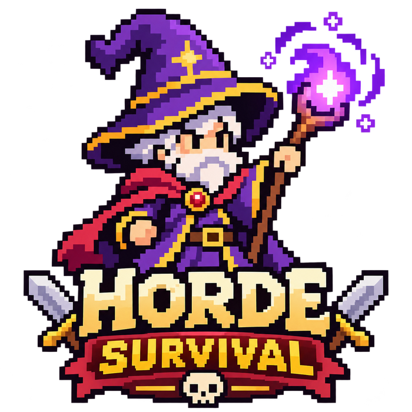
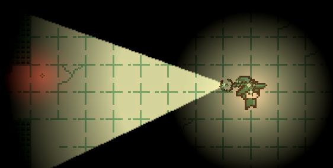
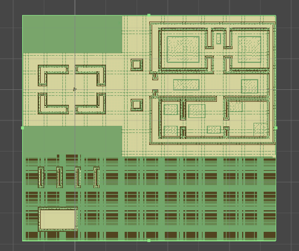
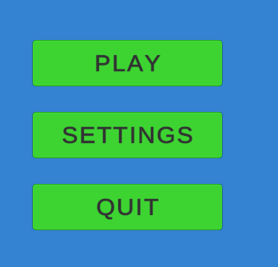
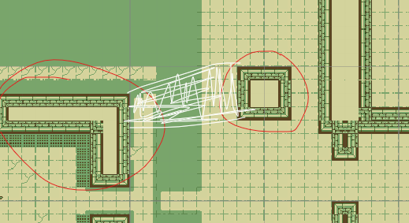

<div align="center">
  

  <p><strong>A 2D isometric horde survival game built with Unity 6 and C#.</strong></p>
  <p>Survive increasingly dangerous enemy encounters using magical projectile attacks, movement and positioning.</p>
  <p>
    <strong><a href="https://vuip96.itch.io/horde-survival">Download the Windows game on itch.io</a></strong>
    &nbsp;·&nbsp;
    <strong><a href="Assets/Scripts">Explore the C# source code</a></strong>
  </p>
</div>

---

## About the project

**Horde Survival** is a playable, single-player survival game developed as part of a Unity game development course. The project brings together gameplay programming, enemy navigation, combat, 2D lighting, menus and audio into a published Windows build.

My focus was on building a complete game loop and organizing gameplay logic into readable, reusable C# components.

## Gameplay preview

<p align="center">
  
</p>

*Gameplay development capture showing the playable character, pixel-art environment and directional lighting.*

### More screenshots

| Level design | Main menu |
| :---: | :---: |
|  |  |
| Tilemap-based level layout | Play, Settings and Quit interface |

> The images above are development snapshots captured during implementation; the [itch.io release](https://vuip96.itch.io/horde-survival) contains the downloadable game.

## Features

- **Player movement:** responsive WASD controls, normalized diagonal movement, directional sprite flipping and walking animations.
- **Mouse-aimed magic combat:** a rotating staff with continuous primary fire and a cooldown-based three-projectile spread attack.
- **Enemy AI:** multiple enemy types pursue the player using Unity NavMesh agents and NavMeshPlus 2D navigation.
- **Progressive difficulty:** enemies spawn at randomly selected valid ground positions, with spawn intervals decreasing over time.
- **Event-driven health system:** damage, regeneration, death events, health bar updates and death animations.
- **Complete game flow:** main menu, gameplay, survival timer, Game Over screen and restart.
- **Audio and settings:** background music, sound effects, Audio Mixer groups and persistent volume preferences.
- **Visual presentation:** pixel-art environment, URP 2D lighting, a directional light effect and UI feedback animations.

## Controls

| Input | Action |
| --- | --- |
| **W / A / S / D** | Move |
| **Mouse** | Aim the magic staff |
| **Hold left mouse button** | Fire the primary projectile attack |
| **Right mouse button** | Fire a three-projectile spread attack |

## Built with

| Technology | Purpose |
| --- | --- |
| **Unity 6** (`6000.0.85f1`) | Game engine and editor |
| **C#** | Gameplay, enemy behavior, UI and audio systems |
| **Universal Render Pipeline (URP)** | 2D lighting and visual effects |
| **Unity 2D Physics / Tilemaps** | Movement, collisions and level construction |
| **Unity AI Navigation + NavMeshPlus** | 2D enemy navigation and pathfinding |
| **Unity UI + Audio Mixer** | Menus, HUD and adjustable audio |
| **Git / GitHub** | Version control and project history |

## Technical highlights

### Component-based C# architecture

The game separates different responsibilities into focused scripts. Values such as movement speed, projectile damage and spawn intervals are configurable through the Unity Inspector.

| Script | Responsibility |
| --- | --- |
| [`PlayerController.cs`](Assets/Scripts/PlayerController.cs) | Keyboard movement, character animation and footsteps |
| [`PlayerStaffController.cs`](Assets/Scripts/PlayerStaffController.cs) | Mouse aiming, fire rates and spread-shot cooldown |
| [`Projectile.cs`](Assets/Scripts/Projectile.cs) | Projectile motion, collisions, damage and hit effects |
| [`EntityHealth.cs`](Assets/Scripts/EntityHealth.cs) | Health, regeneration and C# gameplay events |
| [`Enemy.cs`](Assets/Scripts/Enemy.cs) | Player pursuit through a `NavMeshAgent` |
| [`EnemySpawner.cs`](Assets/Scripts/EnemySpawner.cs) | Tilemap-based spawn points and difficulty progression |
| [`PlayerDeathHandler.cs`](Assets/Scripts/PlayerDeathHandler.cs) | Player death animation and game-over transition |
| [`GameManager.cs`](Assets/Scripts/GameManager.cs) | Game start, time scale, reset and Game Over |
| [`AudioManager.cs`](Assets/Scripts/AudioManager.cs) | Music/SFX routing and saved volume preferences |
| [`HealthBar.cs`](Assets/Scripts/HealthBar.cs) | Event-driven health bar updates |

### Event-driven gameplay

`EntityHealth` publishes `OnHealthChanged` and `OnDeath` events. UI and gameplay components subscribe to the events they need, keeping health calculations separate from visual feedback and death behavior.

### Enemy navigation and scaling difficulty

Enemies use NavMesh agents configured for a 2D environment. The spawner collects valid positions from the ground Tilemap, selects enemies randomly and increases encounter frequency by gradually reducing the spawn cooldown.

<details>
  <summary><strong>View a level-navigation development screenshot</strong></summary>

  <p align="center">
    
  </p>

  <p><em>Development view of navigation/obstacle setup in the Unity Editor.</em></p>
</details>

### Persistent audio preferences

`AudioManager` sends music and sound effects to separate Audio Mixer groups. Slider preferences are stored with `PlayerPrefs`, restored at startup and converted from linear values to decibels before being applied to mixer parameters.

## Download and run

**Windows release**

1. Open the **[Horde Survival itch.io page](https://vuip96.itch.io/horde-survival)**.
2. Download and extract the Windows ZIP file.
3. Launch `Horde Survival.exe`.

**Open the project in Unity**

1. Clone this repository:

   ```bash
   git clone https://github.com/vuip96/unity-horde-survival.git
   ```

2. Open the project folder in Unity Hub using **Unity 6000.0.85f1**.
3. Let Unity import the assets and resolve the packages listed in `Packages/manifest.json`, including NavMeshPlus.
4. Open the gameplay scene in the Project window and press **Play**.

Generated Unity directories such as `Library/`, `Temp/` and `Build/` are excluded by `.gitignore`.

## Project background and credits

This is an educational project developed to practice Unity workflows, C# programming, gameplay architecture, AI navigation, UI implementation, debugging and releasing a complete game.

The project includes course-provided assets and AI-assisted artwork/development support. Third-party assets and dependencies remain subject to their respective license terms.

---

<div align="center">

<strong><a href="https://vuip96.itch.io/horde-survival">Play Horde Survival on itch.io</a></strong> &nbsp;·&nbsp; <strong><a href="Assets/Scripts">Browse the source code</a></strong>

</div>
